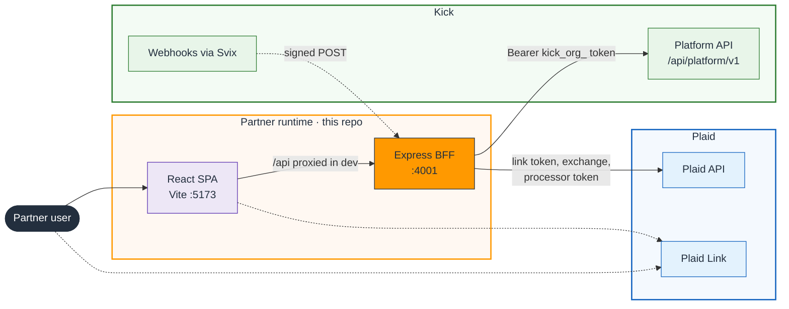
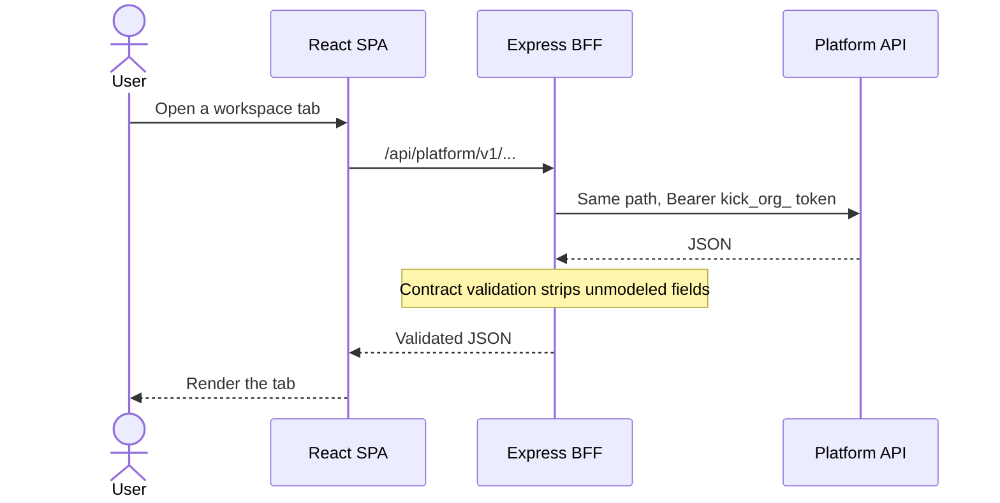
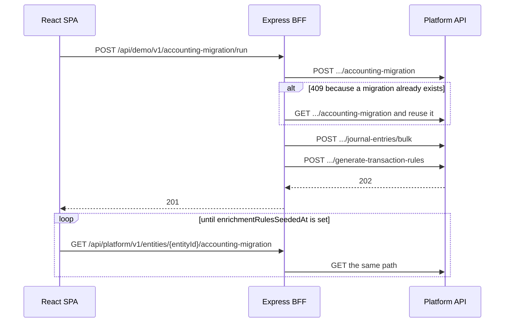
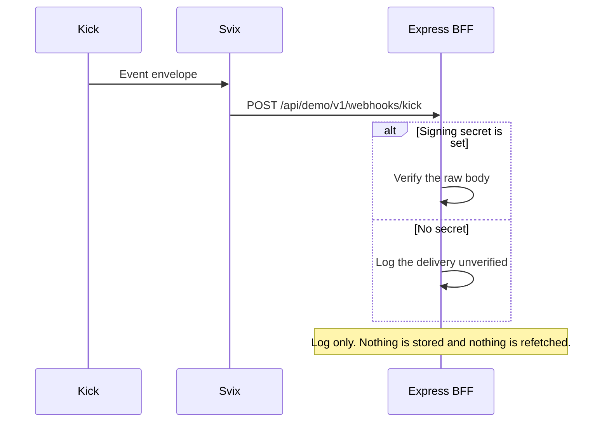
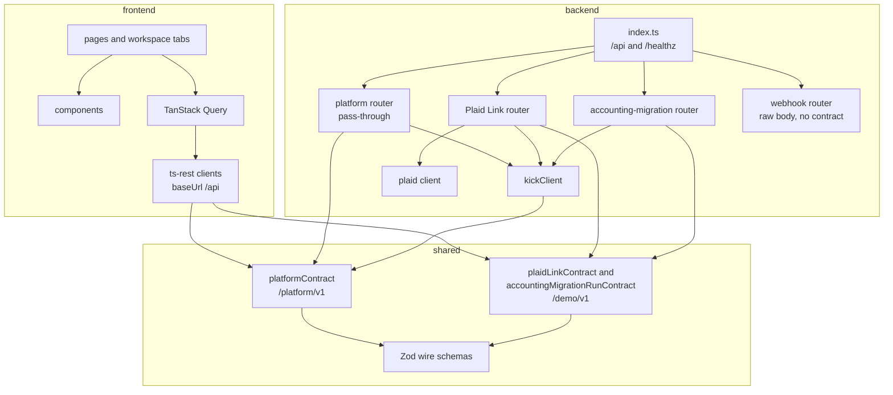

# Architecture

This repo is a partner-shaped client of the Kick Platform API. Kick is the
system of record. The demo stores nothing: no database, no session, no copy of
the books. A React app talks only to an Express backend-for-frontend (BFF),
and the BFF is the only process that holds the organization access token.

Three packages make that work. `shared/` is the wire contract. `frontend/` and
`backend/` both speak it, so the path the browser calls is the same path the
BFF calls on Kick.

## System view

Read this the way you would an AWS architecture diagram. Boxes are deployable
pieces, groups are trust boundaries, solid arrows are synchronous HTTPS the
demo initiates, and dashed arrows are the two paths that do not go through
the BFF as a normal JSON API call: Plaid Link in the browser, and Kick
webhooks delivered by Svix.



| Arrow                   | What crosses it                                                                                                                                         |
| ----------------------- | ------------------------------------------------------------------------------------------------------------------------------------------------------- |
| User → SPA              | Browser UI on http://localhost:5173                                                                                                                     |
| SPA → BFF               | Relative `/api/...`. In dev, Vite proxies that to the BFF. The Kick token is not on this hop.                                                           |
| BFF → Platform API      | The same `/platform/v1/...` path, plus `Authorization: Bearer <kick_org_ token>`. Default host is `https://use-dev.kick.co/api`.                        |
| BFF → Plaid API         | Link-token create, public-token exchange, account lookup, and `processor: "kick"` token create. Plaid credentials stay on the BFF.                      |
| User / SPA ⇢ Plaid Link | The Link UI runs in the browser. The browser receives a link token and returns a public token. It never sees a Plaid access token or a processor token. |
| Svix ⇢ BFF              | `POST /api/demo/v1/webhooks/kick`. Signed raw bytes. The handler logs the delivery and does not write it anywhere.                                      |

`npm run dev` starts both processes. `npm run build` builds the SPA only.
This repo does not ship a production host that serves the static files and
proxies `/api`; the dev proxy is the wiring the diagrams assume.

## Request paths

### Platform API reads and writes

Most of the UI is a pass-through. The BFF adds the token, forwards declared
upstream errors (400, 401, 404, 409, 422, 429), and turns anything else into
502. `responseValidation` parses the upstream body through the contract before
it leaves the BFF, which drops fields the demo does not model.



### Plaid Link

Connecting a bank is the partner's job, not Kick's. Kick accepts a Plaid
processor token and the account fields the partner declares. It does not call
Plaid at creation time. The demo owns that exchange under `/demo/`, so the
mirrored `/platform/v1/` contract stays a mirror.

```mermaid
sequenceDiagram
    actor User
    participant SPA as React SPA
    participant Link as Plaid Link
    participant BFF as Express BFF
    participant Plaid as Plaid API
    participant Kick as Platform API

    SPA->>BFF: POST /api/demo/v1/plaid-link/link-token
    BFF->>Plaid: /link/token/create
    Plaid-->>BFF: link token
    BFF-->>SPA: link token
    SPA->>Link: Open Link
    User->>Link: Pick a USD credit, depository, or loan account
    Link-->>SPA: Public token
    SPA->>BFF: POST /api/demo/v1/plaid-link/connections
    BFF->>Plaid: Exchange the public token
    BFF->>Plaid: Resolve account and institution
    BFF->>Plaid: Create a processor token for kick
    Note over BFF: The Plaid access token never leaves the BFF
    BFF->>Kick: POST /platform/v1/plaid-connections
    Kick-->>BFF: connection
    BFF-->>SPA: connection
```

Without `PLAID_CLIENT_ID` and `PLAID_SECRET` the BFF still boots. Only the
Link flow is off, and those routes answer 503.

### Accounting migration

Kick has no single "migrate historical books" call. The Migration tab posts
once to a demo route, and the BFF chains the three upstream calls. Rule
generation is asynchronous: Kick answers 202, and the SPA polls the mirrored
get until `enrichmentRulesSeededAt` is set.



A 409 on create is ambiguous (a migration already exists, or the entity has
opening balances). The handler reads the resource and reuses an existing
migration, which is what makes a retry after a partial failure work. The bulk
journal-entry call is atomic upstream, so a validation failure creates nothing.

### Webhooks

Kick delivers webhooks through Svix. The receiver is mounted before
`express.json()` because the signature covers the raw body. It is not a
ts-rest route: validating the body against a fixed contract would drop events
Kick adds later. The handler logs the delivery and returns 200. A failed
signature check is the only 400, so Svix retries that delivery. With no
`KICK_WEBHOOK_SIGNING_SECRET`, deliveries are logged unverified.



## Components



### `frontend/`

React, React Router, and TanStack Query. `frontend/src/api/platform.ts`,
`plaid-link.ts`, and `accounting-migration.ts` are ts-rest clients with
`baseUrl: "/api"`. Pages compose components from `frontend/src/components/`.

`/` redirects to `/workspaces`. A workspace is a layout with thirteen tabs:
entities, chart of accounts, account groups, opening balances, Plaid
connections, financial accounts, transactions, counterparties, tasks, task
groups, locks, migration, and reports. Task and counterparty rows open their
own pages under the same layout.

The UI keeps cash-basis books. Reports send `ledgerBasis: "cash"`, and
transactions read and write `accountId` only. Accrual fields stay in
`shared/` so the mirror matches Kick, and no screen offers them.

In dev, `frontend/vite.config.ts` proxies `/api` to `BACKEND_URL`
(default `http://localhost:4001`).

### `backend/`

Express on port 4001 (`BACKEND_PORT`). `backend/src/index.ts` mounts the
API under `/api`, plus a health check:

| Surface                                 | Contract                         | What the handler does                                     |
| --------------------------------------- | -------------------------------- | --------------------------------------------------------- |
| `/api/platform/v1/...`                  | `platformContract`               | Forwards to Kick with the organization token.             |
| `/api/demo/v1/plaid-link/...`           | `plaidLinkContract`              | Runs the Link exchange, then creates the Kick connection. |
| `/api/demo/v1/accounting-migration/run` | `accountingMigrationRunContract` | Chains create, bulk journal entries, and rule generation. |
| `/api/demo/v1/webhooks/kick`            | none                             | Verifies and logs Svix deliveries.                        |
| `GET /healthz`                          | none                             | Returns ok and the configured Kick base URL.              |

`kickClient` in `backend/src/kick-client.ts` is the upstream ts-rest client.
Declared errors pass through. A ts-rest validation envelope from Kick is
unwrapped into a readable 400; an undeclared status becomes 502 via
`UpstreamError`.

Two details are easy to miss from the outside. Array query params use
`key[0]=...`, and the BFF parses them with `arrayLimit: 1000` so a long
general-ledger filter stays an array. Responses set `Cache-Control: no-store`
and disable ETags, so a repeat read is not served from the browser cache.

### `shared/`

Hand-maintained mirror of the Platform API wire shapes this demo uses, plus
the two demo-only contracts. Schemas describe JSON on the wire: ids are
strings, timestamps are ISO strings. Enums are `as const` arrays passed to
`z.enum`. A value Kick adds upstream fails response validation until it is
copied here.

Demo-only routes stay in `plaid-link.contract.ts` and
`accounting-migration.contract.ts`. They are not added to
`platform.contract.ts`.

### Where each resource lives

The workspace screen groups everything under one workspace. The Platform API
does not. Some resources are nested under a workspace or an entity, and some
are organization-level routes that the UI filters itself.

| Scope on the wire | Resources                                                                                           |
| ----------------- | --------------------------------------------------------------------------------------------------- |
| Organization      | Organization, workspaces, entities (filtered by `workspaceId`), Plaid connections, locks            |
| Workspace path    | Financial accounts, transactions, tasks, task groups, counterparties                                |
| Entity path       | Chart of accounts, account groups, opening balances, accounting migration, journal entries, reports |

Classes, ledgers, users, and transaction rules are not vendored. Rules seeded
by a migration show up in the Kick app, not in this demo. Workspace delete is
left out on purpose.

## Secrets

| Variable                          | Where it is used                                     | If it is missing                          |
| --------------------------------- | ---------------------------------------------------- | ----------------------------------------- |
| `KICK_PLATFORM_API_TOKEN`         | `Authorization` on every Kick call                   | The BFF exits at startup                  |
| `KICK_API_BASE_URL`               | Upstream base, default `https://use-dev.kick.co/api` | Default is used                           |
| `PLAID_CLIENT_ID`, `PLAID_SECRET` | Plaid API from the BFF                               | Link flow disabled; everything else works |
| `KICK_WEBHOOK_SIGNING_SECRET`     | Svix verification                                    | Deliveries are logged unverified          |

The token, the Plaid secret, and the webhook signing secret are read in
`backend/src/config.ts` from the environment or from `.env` at the repo root.
None of them are referenced by frontend code.
